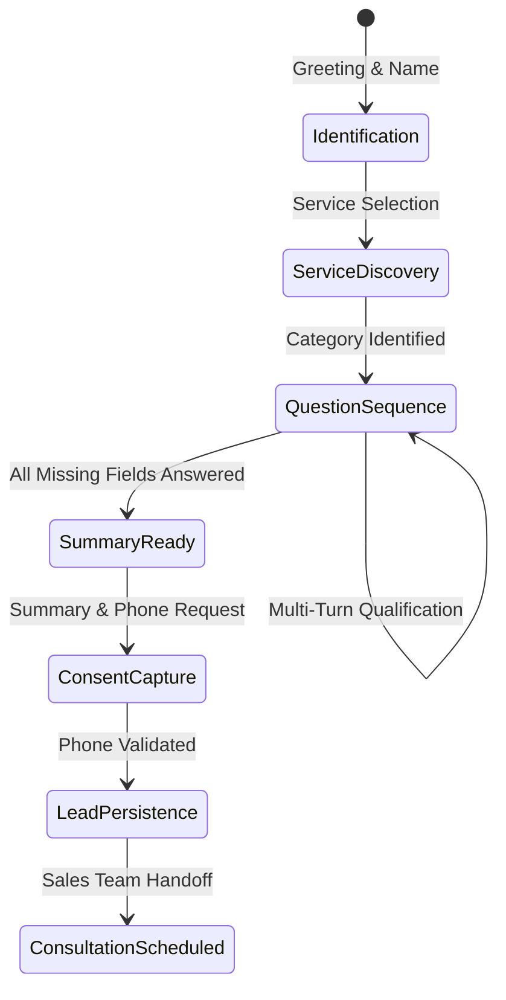

# ESS AI Sales Agent: Conversation State Machine & Memory

> **Engine:** `frontend/lib/ai/salesFlowManager.js`  
> **Extraction:** `frontend/lib/ai/leadExtractor.js`  
> **Route Integration:** `frontend/app/api/public/chat/[botId]/route.js`  

---

## 1. State Machine Architecture

The conversation state machine coordinates inbound prospect qualification through deterministic steps, preventing model drift, circular loops, and repeated questions.



---

## 2. State Representation Schema

Each conversation session persists a state object:

```javascript
{
  conversationId: "conv_1741234567_abc",
  botId: "bot_aa",
  status: "in_progress", // "not_started" | "in_progress" | "summary_ready" | "completed"
  service: "website",    // "website" | "mobile" | "ai_bot" | "custom_software" | ...
  currentStage: "budget",// active question ID
  askedQuestions: [
    "is_business",
    "is_redesign",
    "website_type",
    "budget"
  ],
  answers: {
    is_business: true,
    is_redesign: false,
    website_type: "business",
    budget: "under_50k"
  },
  customerName: "Aniket Shukla",
  contactRecorded: "+91 77676 76666",
  consentAsked: true,
  summary: "Website Development: Business website, new build, budget: under ₹50,000"
}
```

---

## 3. Mandatory Behavioral Rules Implemented

### A. Zero Repeated Questions
- When an attribute is extracted (e.g., `budget: "under_50k"`), `getNextQuestion()` filters out previously answered question IDs.
- If a customer answers multiple questions in a single turn (*"I need a business website built from scratch with a budget of ₹40,000"*), all 3 attributes (`is_business: true`, `is_redesign: false`, `budget: "under_50k"`) are registered simultaneously.

### B. Anti-Collision Name Filtering
- Words that answer qualification options (such as `"Both"`, `"Yes"`, `"New website"`, `"Portfolio"`, `"Android"`) are strictly blocked by `isValidPersonName()` and `NON_NAME_WORDS` in `leadExtractor.js`, preventing the bot from treating choices as prospect names.

### C. Direct Business Question Intercept
- If a prospect asks a technical or company question mid-qualification (*"Where is your office located?"* or *"Do you use Next.js?"*), `detectDirectBusinessQuestion()` prepends a brief 1-2 sentence factual answer, then immediately resumes qualification without losing state.

### D. Idempotent Lead Persistence
- Lead capture verifies phone formatting against Indian 10/12-digit rules (`+91 XXXXX XXXXX`).
- `leadsStore.createLead()` performs an idempotent upsert: if the conversation session already submitted a lead, it updates requirements and answers rather than creating duplicates.
- If database connectivity fails, the bot reports the issue honestly (*"I encountered a temporary connection issue..."*) and invites a direct retry or email to `contact@emperorsmartsolutions.com`.
