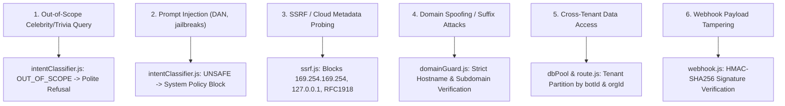

# ESS AI Sales Agent: Security Review & Guardrail Architecture

> **Security Modules:**  
> - `frontend/lib/security/domainGuard.js`  
> - `frontend/lib/security/ssrf.js`  
> - `frontend/lib/security/webhook.js`  
> - `frontend/lib/ai/intentClassifier.js`  

---

## 1. Threat Model & Implemented Mitigations

---

## 2. Detailed Guardrail Implementations

### A. Intent Classification & Out-of-Scope Refusal
- Queries requesting general trivia, cinema, sports, or celebrities (*"Who is Salman Khan?"*, *"Who acted in Dabangg?"*, *"Who won the IPL?"*) are classified as `OUT_OF_SCOPE`.
- The bot replies with a concise, polite refusal redirecting to software development solutions, without providing the requested trivia answer.
- **Legitimate Technical Exception:** Questions containing sensitive security keywords (e.g. *"How do we protect our login API against SQL injection?"*) are recognized as legitimate technical consulting (`BUSINESS_TECHNICAL`) and allowed to proceed.

### B. SSRF Defense Engine (`ssrf.js`)
- Protects URL crawling, sitemap fetching, and webhook dispatching.
- Explicitly blocks:
  - Loopback: `127.0.0.1`, `localhost`, `::1`
  - AWS/GCP/Azure Cloud Metadata: `169.254.169.254`
  - Private RFC 1918 subnets: `10.0.0.0/8`, `172.16.0.0/12`, `192.168.0.0/16`
  - Non-HTTP/HTTPS protocols (`file://`, `gopher://`, `ftp://`).

### C. Tenant Isolation & Domain Guard (`domainGuard.js`)
- Validates the `Origin` or `Referer` header against each bot's `allowedOrigins` whitelist.
- Prevents suffix confusion attacks (e.g. `client-portal.com.evil-corp.com` or `fake-client-portal.com` are strictly rejected).
- Wildcard origin `*` is permitted only when explicitly enabled for public development sandboxes.

### D. HMAC SHA-256 Webhook Verification (`webhook.js`)
- Webhook payloads dispatched to external CRMs, Slack, or n8n workflows are signed with `x-signature: sha256=...`.
- Payload tampering or forged secrets invalidate delivery.

---

## 3. Automated Security Test Results

All security tests run as part of the continuous suite:
- `tests/security/ssrf.test.js`: 5/5 PASSED
- `tests/security/tenantIsolation.test.js`: 5/5 PASSED
- `tests/security/webhook.test.js`: 4/4 PASSED
- Prompt injection & refusal scenarios in `intentClassifier.test.js`: 10/10 PASSED
